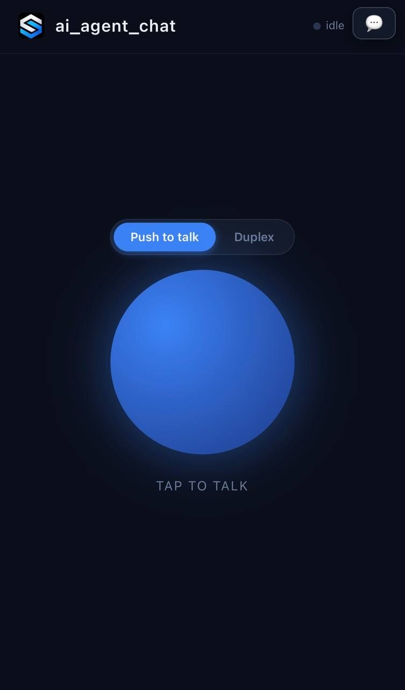
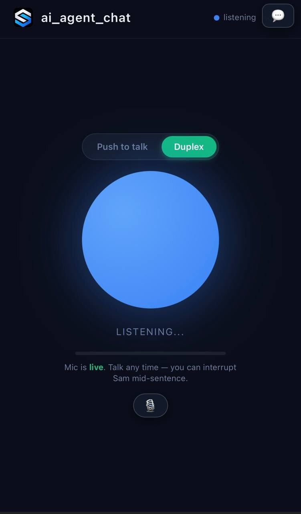

# ai_agent_chat

[](LICENSE)
[](https://www.python.org/downloads/)
[](https://fastapi.tiangolo.com/)
[](https://reuse.software/)

A private, mobile-first voice agent. Talk to your LLM the way you'd
talk to a person: push to talk, or go fully duplex and interrupt it
mid-sentence.

Runs entirely on your own hardware. Your voice never leaves the
machine — STT, the LLM bridge, and TTS are all local. The only thing
that needs to be reachable is the bridge itself, and the recommended
way to reach it from your phone is a VPN (Tailscale, WireGuard, etc.).

<p align="center">
  
  
</p>

---

## Why

Most voice assistants are half-duplex: you press a button, you talk,
it talks, and you cannot interrupt it. The interruption is the whole
point of a conversation.

`ai_agent_chat` does real full-duplex:

- **Barge-in.** Talk over the agent and it stops mid-sentence and
  listens to what you actually said.
- **Persistent mic.** In duplex mode the microphone never turns off.
  You never touch the screen.
- **Interrupts carry forward.** The words you use to interrupt become
  the next request — you don't have to say them twice.
- **Local by default.** Whisper for STT, Piper or Kokoro for TTS. The
  LLM is the only thing that leaves the machine, and that's
  configurable.

## Requirements

| | |
|---|---|
| **OS** | macOS (primary), Linux should work |
| **Python** | ≥ 3.11 |
| **Hardware** | Apple Silicon recommended (whisper.cpp uses Metal) |
| **STT** | [`whisper.cpp`](https://github.com/ggerganov/whisper.cpp) server |
| **TTS** | [`piper`](https://github.com/rhasspy/piper) (or `kokoro`) |
| **ffmpeg** | required — the browser sends webm/opus, whisper wants WAV |
| **Network** | a VPN or mesh network for phone access |

Runtime Python dependencies:

```
fastapi
uvicorn
requests
numpy
```

Optional:

```
kokoro         # alternative TTS voice
soundfile      # kokoro dependency
python-dotenv  # .env loading
websockets     # only needed to run the test suite
```

## Install

```bash
git clone https://github.com/DuNorth595/ai_agent_chat.git
cd ai_agent_chat

python3 -m venv .venv
source .venv/bin/activate
pip install -r requirements.txt
```

Install the two local binaries:

```bash
# whisper.cpp — build it, then run the server
# https://github.com/ggerganov/whisper.cpp
./build.sh
./main -m models/ggml-base.en.bin --host 127.0.0.1 --port 8178

# Piper
brew install piper
# and download a voice model into ~/.local/share/piper/voices/
```

Download a Piper voice:

```bash
mkdir -p ~/.local/share/piper/voices
curl -LO https://huggingface.co/rhasspy/piper-voices/resolve/main/en/en_US/amy/medium/en_US-amy-medium.onnx
curl -LO https://huggingface.co/rhasspy/piper-voices/resolve/main/en/en_US/amy/medium/en_US-amy-medium.onnx.json
```

## Configuration

Copy the example and edit it:

```bash
cp .env.example .env
```

`.env` is gitignored. **Never commit it.**

| Variable | Default | What it does |
|---|---|---|
| `BRAIN_API_KEY` | — | API key for the LLM provider. **Required.** |
| `BRAIN_MODEL` | `MINIMAX-M3` | Model id passed to the provider |
| `BRAIN_API_URL` | Anthropic-compatible endpoint | Where the LLM call goes |
| `BRAIN_MAX_TOKENS` | `2000` | Response cap. See [Known bugs](#known-bugs) |
| `AVA_HOST` | `0.0.0.0` | Bind address. `0.0.0.0` so the VPN can reach it |
| `AVA_PORT` | `8770` | Listen port |
| `AVA_CORS_ORIGINS` | `*` | Allowed origins. Narrow this in production |
| `AVA_HTTPS` | `1` if certs exist | Set `0` to force plain HTTP (localhost only) |
| `AVA_TLS_CERT` / `AVA_TLS_KEY` | `certs/server.crt` / `.key` | TLS files. Browsers require HTTPS for mic access |
| `AVA_TTS_PROVIDER` | `piper` | `piper` or `kokoro` |
| `PIPER_BIN` | `piper` | Path to the piper executable |
| `PIPER_MODEL_DIR` | `~/.local/share/piper/voices` | Where voice models live |
| `PIPER_MODEL` | `en_US-libritts_r-medium` | Voice model name (no `.onnx`) |
| `WHISPER_URL` | `http://127.0.0.1:8178/inference` | whisper.cpp server endpoint |
| `AVA_BARGE_IN` | `0` | Set to `1` to enable barge-in / duplex |
| `AVA_BARGE_CAPTURE_MAX_MS` | `8000` | Max time to collect an interrupted utterance |
| `AVA_BARGE_ENDPOINT_BLOCKS` | `12` | Silence (30 ms blocks) that ends an utterance |
| `AVA_BARGE_TRACE` | `0` | Set to `1` to log mic RMS levels (tuning) |
| `MEMORY_IDENTITY_FILE` | `identity.md` | Optional life-memory identity file |
| `TELEGRAM_BOT_TOKEN` | — | Optional Telegram bridge |
| `TELEGRAM_HOME_CHANNEL` | — | Optional Telegram chat id |

### TLS

iOS Safari **will not grant microphone access over plain HTTP** (except
on `localhost`). You need HTTPS. For a self-signed certificate:

```bash
mkdir -p certs
openssl req -x509 -newkey rsa:4096 -nodes \
  -keyout certs/server.key -out certs/server.crt \
  -days 365 -subj "/CN=ai-agent-chat" \
  -addext "subjectAltName=DNS:ai-agent-chat,DNS:localhost,IP:127.0.0.1"
```

Then point `AVA_TLS_CERT` / `AVA_TLS_KEY` at them and accept the
warning on the device. If you're on a tailnet, Tailscale's own HTTPS
certificates (`tailscale cert`) are a better option.

## Running it

```bash
source .venv/bin/activate
python agent_voice_ai.py
```

Then open `https://<your-host>:8770/`.

For macOS, run it under launchd so it survives reboots. An example
plist is in `examples/`:

```bash
cp examples/com.agent-voice-ai.bridge.plist \
   ~/Library/LaunchAgents/com.agent-voice-ai.bridge.plist

# edit the paths inside it, then:
launchctl bootstrap gui/$(id -u) ~/Library/LaunchAgents/com.agent-voice-ai.bridge.plist
```

**Restart it correctly** — `kickstart` reuses the cached job
definition, so a new environment variable will not reach the process
until you reload the plist:

```bash
launchctl kickstart -k gui/$(id -u)/com.agent-voice-ai.bridge
```

If you add or change an environment variable in the plist, also put it
in `.env` (the app loads `.env` with `override=False`, so the plist
wins when both are set). Verify what the running process actually has
with `GET /api/health` — `ps eww` is not reliable.

## Accessing it from your phone

**This is the part people get wrong, and it determines whether the app
works at all.**

The browser will not give a web page microphone access unless the page
is served over HTTPS. On a LAN address like `https://192.168.1.50:8770`
the certificate won't match, and iOS Safari's microphone permission
prompt never appears. You will tap the orb, nothing happens, and the
app looks broken.

**Use a VPN or mesh network.** The bridge binds to `0.0.0.0` and
listens on one port; everything else is routing.

### Tailscale (recommended)

```bash
# 1. Install Tailscale on the Mac and the phone, sign in to the same tailnet.
# 2. Find the Mac's tailnet address:
tailscale status | grep -i "$(hostname)"
#    -> 100.x.y.z   my-machine   user@example.com   macOS   -
# 3. Open that address on the phone:
#    https://100.x.y.z:8770
```

Tailscale gives you a real HTTPS story:

```bash
tailscale cert my-machine.tailnet.ts.net
# writes my-machine.tailnet.ts.net.crt and .key
```

Point `AVA_TLS_CERT` / `AVA_TLS_KEY` at those, open
`https://my-machine.tailnet.ts.net:8770`, and the cert is valid —
no warning, and the mic works on the first tap.

### WireGuard or any other VPN

Same idea: connect the phone to the VPN, open the server's VPN
address over HTTPS, accept the self-signed cert once.

### Plain LAN (works, with caveats)

You *can* reach it over the LAN, but you will have to accept the
certificate warning on every new device, and some iOS versions will
refuse the microphone on a certificate you haven't explicitly trusted.
If the mic doesn't prompt, this is why.

### What NOT to do

- **Do not port-forward it to the open internet.** The bridge has no
  authentication, no rate limiting, and no CSRF protection. Anything
  that can reach the port can use your LLM key and read the memory
  context it sends.
- **Do not bind it to a public interface** thinking a password will
  save you. There isn't one.

If you need access from an untrusted network, put an authenticating
proxy in front of it.

## Using it

### Push to talk

Tap the orb, talk, release. The orb shows the state: `listening`,
`thinking`, `speaking`, `idle`.

### Duplex

Flip the toggle to **Duplex** and tap the orb once (iOS requires a
gesture before it will open the mic). After that:

- The mic stays open the whole time.
- Talk whenever you want. The agent hears you, stops talking, and
  answers what you said.
- If you talk over it, it cuts off mid-sentence.
- The **mute button** (below the orb) disables the microphone track
  entirely — the OS stops capturing, not just the upload.

### Icons

| Control | Meaning |
|---|---|
| 💬 | Chat is hidden; tap to show it |
| 💬❌ | Tap to hide the chat |
| 🎙️ / 🔇 | Microphone live / muted |

## Architecture

One file does most of the work: `agent_voice_ai.py` contains the HTTP
API, the WebSocket handler, the embedded HTML/JS page, and the
barge-in logic. The rest are small modules:

| File | Role |
|---|---|
| `agent_voice_ai.py` | The server, the page, and the duplex loop |
| `barge.py` | Voice-activity detection (the barge-in engine) |
| `brain.py` | LLM agent loop, streaming, tool calls, prompt caching |
| `tools.py` | The agent's tool surface (time, system info, exec) |
| `memory.py` | Long-term memory context (optional) |
| `whisper_stt.py` | STT client for whisper.cpp |
| `piper_tts.py` / `kokoro_tts.py` | TTS providers |
| `skills_bridge.py` | Optional skills context |
| `telegram_sync.py` | Optional Telegram bridge |

### The barge-in engine

`barge.py` is a port of the voice-activity detector from the
**Hermes** agent framework (`tools/voice_mode.py`), adapted for audio
arriving over a WebSocket instead of a local sound device.

It is a port rather than an import because this repository is
standalone and must not depend on another project being installed.
The state machine, thresholds, and grace logic are unchanged:

```python
SILENCE_RMS_THRESHOLD     = 200
PLAYBACK_MIN_TRIGGER      = 1500.0
TRIGGER_CEILING           = 4000.0
DEFAULT_BARGE_MULTIPLIER  = 3.0
```

Two behaviours matter:

- The quiet floor is calibrated from the room **before** any TTS
  starts. Calibrating during playback would learn the agent's own
  echo as "quiet" and the detector would never trip.
- Playback bleed must not trip while the agent is speaking. There is
  a unit test for exactly this.

### The duplex loop

```
phone (mic always hot)  ──pcm frames──▶  bridge
                                          │
                    ┌─────────────────────┴─────────────────────┐
                    │  collect → endpoint → transcribe → answer  │
                    └─────────────────────┬─────────────────────┘
                                          │
     ◀────── text + WAV audio ────────────┘
                                          │
     ── barge_stop (user went quiet) ─────▶│  ← next utterance
```

One reader task owns the socket for the whole session, so the collect
phase and the reply phase share a single detector and a trip detected
in one is visible to the other.

## The wire protocol

The WebSocket at `/ws` speaks JSON.

**Client → server**

```jsonc
{"type": "duplex", "session_id": "..."}   // open a persistent duplex session
{"type": "start",  "session_id": "..."}    // open a push-to-talk turn
{"type": "pcm",   "data_b64": "..."}       // 30 ms of PCM16 mono 16 kHz
{"type": "barge_stop"}                     // the user stopped talking
{"type": "mute",  "value": true}           // microphone muted
{"type": "playing", "value": true}         // audio playback started/stopped
{"type": "duplex_off"}                     // end the session
{"type": "text",  "text": "..."}           // text-only turn
{"type": "ping"}
```

**Server → client**

```jsonc
{"type": "state", "state": "listening"|"thinking"|"speaking"|"idle"}
{"type": "transcript", "final": "..."}     // what the server heard
{"type": "text", "role": "sam", "text": "..."}
{"type": "audio", "format": "wav", "sample_rate": 22050, "data_b64": "..."}
{"type": "barge_in", "phase": "generation"|"playback"}
{"type": "keepalive"}
{"type": "done", "stop_reason": "end_turn"}
```

`phase` tells you what was interrupted:

- `generation` — the model was still producing text; nothing audible
  had shipped yet.
- `playback` — the agent was audibly speaking and got cut off
  mid-sentence. This is the one that feels like real conversation.

## Tests

The suite drives a real bridge over a real WebSocket. Speech tests
synthesize real audio with Piper and assert the server transcribes the
actual words.

```bash
source .venv/bin/activate
python tests/test_barge_detector_unit.py   # VAD unit tests (no server needed)
python tests/test_duplex_real.py           # end-to-end: speak → transcribe → answer
python tests/test_duplex_interrupt.py      # interrupt mid-reply
python tests/test_duplex_twice.py          # two consecutive turns
python tests/test_mute.py                  # mute → silence → unmute → speak
python tests/test_barge_ab.py              # quiet user vs. interrupting user
python tests/test_barge_playback.py        # phase=playback
python tests/test_no_double_play.py        # the audio fallback guard
```

The speech tests need Piper and a voice model. If they can't find
them they **skip** rather than fail. Point them somewhere else with:

```bash
export AVA_TEST_PIPER=/path/to/piper
export AVA_TEST_PIPER_MODEL=/path/to/voice.onnx
```

Most tests need the bridge running and `AVA_BARGE_IN=1` set.

## Known bugs

See [KNOWN_BUGS.md](KNOWN_BUGS.md) for the full list. The ones that
bite hardest:

**1. Long answers can be cut off by the WebSocket timeout.**
A long reply (the model thinking for 30 s, then dozens of TTS
sentences) can exceed the server's ping timeout and the connection
drops mid-reply. Fixed by disabling the ping timeout and sending
`keepalive` frames between sentences, but very long replies are still
slow: Kokoro renders ~13 s of audio per sentence.

**2. `BRAIN_MAX_TOKENS` is a hard response cap.**
If a reply hits the cap it is truncated rather than continued. Raise
`BRAIN_MAX_TOKENS` for long-form answers.

**3. The browser may drop in-flight WebSocket frames.**
iOS Safari occasionally drops large frames. The server sends a
complete `/api/audio/<id>.wav` fallback for this reason, and the
client plays it **only** if no streamed audio arrived — so you never
hear the reply twice.

**4. The `playing` signal is best-effort.**
The client tells the server when audio starts and stops so the
detector can pick the right threshold. If those messages are lost,
the detector may use the wrong threshold for a turn.

**5. `AVA_BARGE_TRACE=1` is noisy.**
It logs mic RMS levels every 10 frames. Turn it off in production.

## FAQ

**The mic button does nothing.**
The page is not on HTTPS, or the certificate isn't trusted. iOS
Safari will not open the microphone on an untrusted certificate. Use
Tailscale certificates or a proper cert.

**"I can hear you clearly" but it never answers.**
Check `/api/health`. `barge_in.enabled` should be `true` and your
`.env` should have `AVA_BARGE_IN=1`. If the flag is `false`, the
duplex path is disabled.

**It answers twice.**
You are probably on an old cached page. The server sends a complete
audio fallback; the client only plays it when no streamed audio
arrived. A stale client plays both. Hard-refresh.

**The reply restarts and repeats.**
Fixed in v0.10.1 — the agent loop no longer re-runs when it hits the
token cap. If you still see it, you are on an old page.

**Can I use it without a VPN?**
On a LAN, yes, but you will fight certificate warnings and iOS may
refuse the microphone. A VPN is strongly recommended. Never expose the
port to the internet — there is no authentication.

**Does it work on Linux?**
The server code is portable. whisper.cpp and Piper both ship Linux
builds. The launchd plist is macOS-specific; use systemd instead.

**How do I change the voice?**
Set `PIPER_MODEL` in `.env` to the model filename (without `.onnx`)
and put the `.onnx` and `.onnx.json` in `PIPER_MODEL_DIR`.

**Why is the first reply slow?**
The agent may run several tool calls before it says anything. That's
expected — it is thinking, and you can interrupt it.

**How do I add a tool?**
`tools.py` holds the tool surface; `brain.py` wires them into the
provider's tool schema. See [AGENTS.md](AGENTS.md).

## For agents working on this codebase

Read [AGENTS.md](AGENTS.md). It has the repo map, the conventions
that matter, and a list of traps that have already cost hours.

## License

MIT — see [LICENSE](LICENSE).

SPDX-License-Identifier: MIT

The canonical MIT text is also in [LICENSES/MIT.txt](LICENSES/MIT.txt).
Every source file carries an SPDX header:

```
SPDX-FileCopyrightText: 2026 Justin Douglas
SPDX-License-Identifier: MIT
```

This repository follows the [REUSE](https://reuse.software/)
specification — `LICENSES/` plus `.reuse/dep5` for the tree-wide
declaration. Tools like [`reuse lint`](https://github.com/fsfe/reuse-tool)
pass cleanly.
